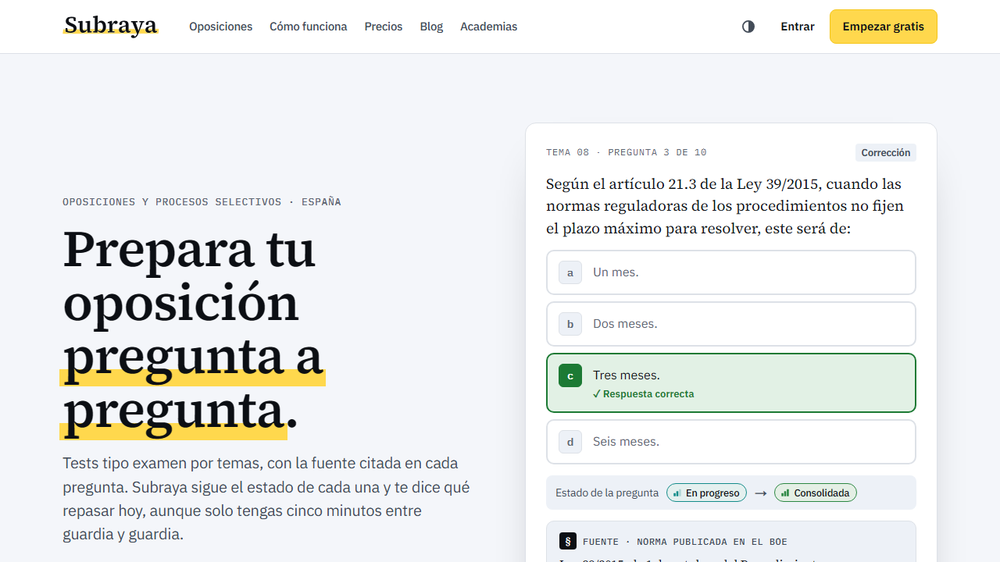
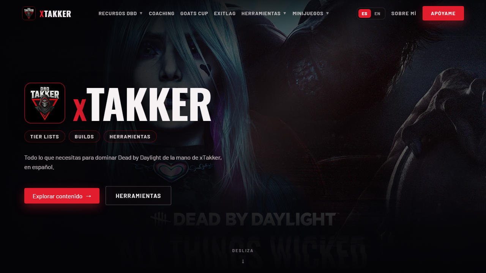

## Proyectos activos

<table>
<tr>
<td width="50%" valign="top">

<h3><a href="https://subraya.es">Subraya</a></h3>
Tests de oposiciones por temas, con la ley o la página del temario citada en cada respuesta y el estado de cada pregunta para saber qué repasar hoy.
  <code>Next.js</code> <code>TypeScript</code> <code>Prisma</code> <code>PostgreSQL</code> <code>Python</code>
</td>
<td width="50%" valign="top">

<h3><a href="https://dbdtakker.com">DBDTakker</a></h3>
Todo lo necesario para dominar Dead by Daylight en español, de la mano de xTakker: tier lists, builds, guías, infografías y herramientas.
  <code>JavaScript</code> <code>Python</code> <code>Docker</code> <code>Cloudflare</code>
  
</td>
</tr>
</table>
